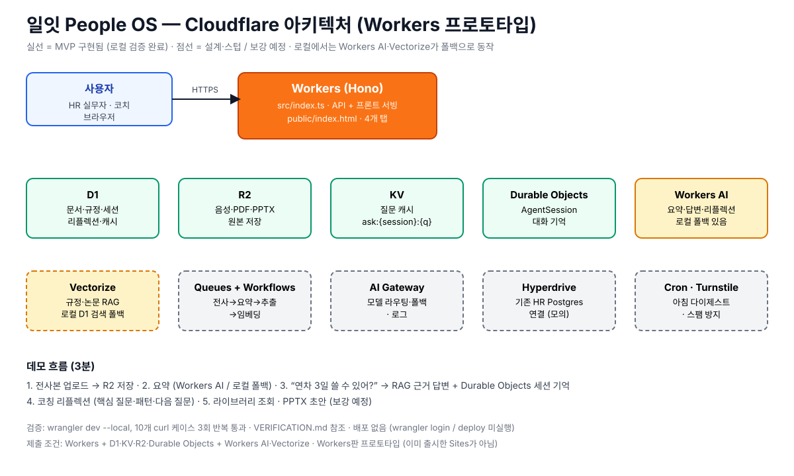
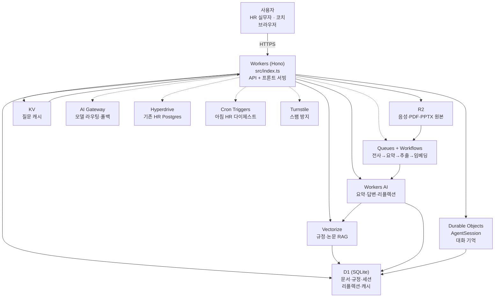

# 아키텍처 — 일잇 People OS (Workers 프로토타입)

> 파일: `architecture.svg`가 제출용 다이어그램 이미지. 아래 Mermaid는 같은 내용을 텍스트로 표현한 것.
> MVP(Phase 1–3)는 실선, 보강 예정(Phase 4·5)은 점선으로 구분했다.

## 다이어그램

## 요청 흐름 (데모 1개 흐름)

1. **업로드** — `POST /api/documents` {title, content, kind}
   브라우저 → Workers → R2에 원본 저장 + D1에 메타 저장. 201 반환.
2. **요약** — `POST /api/documents/:id/summarize`
   Workers AI 요약 시도 → 로컬에선 `local-extractive`로 폴백. 3줄 요약 + 액션 2개 → D1 저장.
3. **질문 (RAG)** — `POST /api/ask` {question, sessionId}
   KV 캐시 확인 (`ask:{sessionId}:{question}`) → 없으면 Vectorize 검색 시도 → 로컬에선 D1 텍스트 검색 폴백 → 근거 문서(연차휴가 등) + 답변 생성 → Durable Objects 세션에 대화 저장 → KV에 캐시.
4. **코칭** — `POST /api/coaching/reflect` {transcript, sessionId}
   Workers AI 분석 시도 → 로컬에선 `local-rule`로 폴백. 핵심 질문·패턴·다음 질문 → D1 저장.
5. **조회** — `GET /api/library`, `GET /api/seed`
   문서·규정 7건·리플렉션 목록 반환.

## Cloudflare 기능 매핑 (공모전 필수 조건)

필수: Workers + (KV·D1·Durable Objects·Hyperdrive·R2 중 1개) + 다른 Cloudflare 제품 1개.
이 프로젝트는 Workers + D1 + KV + R2 + Durable Objects + Workers AI + Vectorize를 쓴다.

| 기능 | MVP 상태 | 하는 일 | 폴백 (로컬) |
|---|---|---|---|
| Workers | 구현됨 | Hono API + 프론트 서빙 | — |
| D1 | 구현됨 | 문서·규정·세션·리플렉션·캐시 테이블 | Miniflare 로컬 D1 |
| R2 | 구현됨 | 원본 파일 저장 (`r2Stored: true` 확인) | Miniflare 로컬 R2 |
| KV | 구현됨 | 질문 캐시, 세션별 키 | D1 cache 테이블 |
| Durable Objects | 구현됨 | AgentSession 대화 기억 | D1 sessions 테이블 |
| Workers AI | 코드 있음, 로컬 폴백 | 요약·답변·리플렉션 생성 | local-extractive / local-template / local-rule |
| Vectorize | 코드 있음, 로컬 폴백 | 규정·논문 임베딩 검색 | D1 텍스트 검색 |
| Queues + Workflows | 설계·스텁 | 전사→요약→추출→임베딩 비동기 파이프라인 | 직접 호출 |
| AI Gateway | 설계만 | 모델 라우팅·폴백·로그 | — |
| Hyperdrive | 설계만 | 기존 HR Postgres 연결 | 모의 데이터 |
| Cron Triggers | 설계만 | 아침 HR 다이제스트 | 스케줄러 함수 자리만 |
| Turnstile | 설계만 | 가입·업로드 스팸 방지 | 폼 자리만 |
| Workers Static Assets | 구현됨 | `public/index.html` 서빙 | — |

## 데이터 모델 (migrations/0001_init.sql)

- `documents(id, title, kind, content, r2_key, created_at)`
- `policies(id, title, section, content)` — 시드 7건
- `cache(key, value, created_at)` — KV 폴백
- `sessions(id, data, updated_at)` — DO 폴백
- `reflections(id, session_id, transcript, result, created_at)`
- `tickets(id, title, body, status, created_at)` — 에이전트 티켓 초안용

## 로컬 vs 클라우드 차이 (솔직한 기록)

- 로컬(`wrangler dev --local`)에서는 Workers AI·Vectorize가 안 돈다. `VERIFICATION.md`에 경고 문구 원문과 폴백 엔진을 기록했다.
- `compatibility_date`는 wrangler 3.114.17이 지원하는 최신 `2025-07-18`로 맞췄다.
- 배포 후에는 같은 코드가 바인딩을 그대로 써서 Workers AI·Vectorize를 탄다. 배포 전에는 그 동작을 검증할 수 없다고 README에 명시했다.

## 원본 자산과의 관계

- `people-insight`의 FastAPI+Turso+n8n+Vercel → Workers+D1+Queues/Workflows+Static Assets
- `oss-agent-lab`의 Qdrant RAG + LangGraph 라우터 → Vectorize + Durable Objects 세션
- `enterprise-ops-agent`의 ADK ReAct → `/api/ask` 라우터·근거 표시
- ChatGPT Sites(Plaud Transcribe Studio, Paperdoc, easy-slides, People Signal 등) → 입력·출력 모듈의 화면·흐름 참고. 단, 이 제출물은 Sites 자체가 아니라 Workers 위에 새로 만든 프로토타입이다.
- FlowDesk Cloud(개인 작업 공간 Site, https://flowdesk-personal-c7a4.hr-jhkang.chatgpt.site/) → 요약·액션·리플렉션 결과의 저장처. FlowDesk는 별도 비공개 Site라 Worker 안에 직접 넣을 수 없어, 데모 화면의 "FlowDesk에서 열기" 링크 + "요약 복사" 버튼으로 연결한다 (MVP 범위 내 구현됨). 클라우드 자료는 로그인한 계정의 공간에 저장되고 PC와 자동 동기화되지 않는다.
- 화면 스타일: `people-insight`의 CSS 디자인 토큰(남색 #123863, 배경 #f5f8fc, 포인트 #2d7dde, 카드 radius 16px, Pretendard/Inter)을 `public/index.html`에 그대로 적용했다. Mantine 라이브러리가 아니라 Mantine처럼 보이게 짠 커스텀 CSS다.
