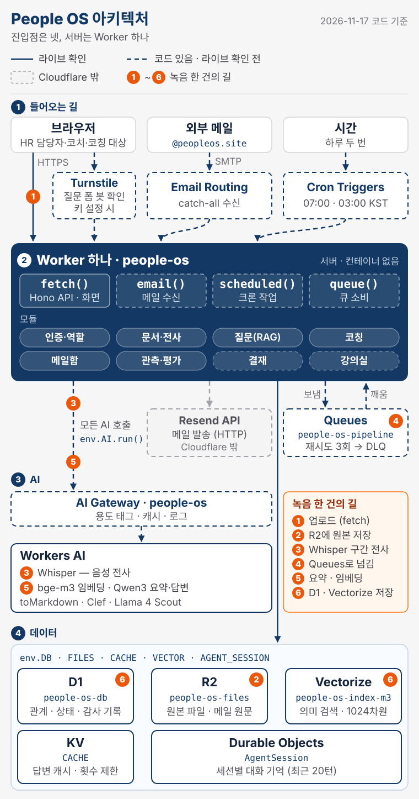

# 일잇 People OS — 서버 없이 Worker 하나로 돌아가는 HR·코칭 에이전트 업무 공간

> **English summary** — *People OS* is an HR and coaching workspace that runs as **a single Cloudflare Worker, with no backend server**. One Worker handles the web UI (Static Assets), the API, inbound email (Email Routing), queue consumers, and cron jobs. Data lives in D1, R2, KV and Vectorize; every AI step — Whisper transcription, bge-m3 embeddings, Qwen3.8 answers, Clef "judgment" models for routing / guarding / re-ranking, and nightly self-evaluation — runs on Workers AI through AI Gateway. Q&A, transcription and coaching follow fixed pipelines that retrieve evidence and answer *only with sources*; a **workflow builder** (15 node types, run on Queues, with an ReAct-style agent node backed by a Durable Object, capped at 10 steps) lets users chain steps. Anything that leaves the system (email, webhook) stops at an **approval gate** until a person approves it, and anything that changes the organization's knowledge is decided by a person. Five Durable Objects handle conversation memory, the agent loop, chat rooms, real-time notifications and the rate limiter. This is a new prototype built on Workers for Cloudflare Developer Day Seoul 2026 (Use Case contest), not a released product. Docs are in Korean. Live demo: https://people-os.workspace-easyware.workers.dev (an account is required; the judge account is given in the submission form).

**링크** · [라이브 데모](https://people-os.workspace-easyware.workers.dev) · 발표자료(앱 안 "발표자료" 메뉴 · 독립 페이지 `/pitch.html`) · [아키텍처 문서](ARCHITECTURE.md) · [3분 데모 대본](DEMO-SCRIPT.md) · 데모 영상(제출 후 링크 추가)

> **이것은 Workers 위에 새로 만든 프로토타입입니다. 정식 출시한 서비스가 아닙니다.**
> Cloudflare Developer Day Seoul 2026 Use Case 공모전(마감 2026-11-27, 행사 2026-12-02) 제출용입니다.
> 저장소는 제출 직전에 공개 전환할 예정입니다.

## 30초 요약

1. **백엔드 서버가 없습니다.** Worker 하나가 화면, API, 메일 수신, 큐 처리, 예약 작업을 맡습니다.
2. **데이터 저장소가 다 있습니다.** 관계형은 D1, 파일은 R2, 캐시는 KV, 의미 검색은 Vectorize. 바인딩 한 줄씩으로 붙습니다.
3. **AI가 에이전트로 일합니다.** 전사·요약·답변·코칭·평가·판단이 모두 Workers AI에서 돕니다. 여러 모델이 단계를 나눠 맡고, 워크플로우로 단계를 이어 붙일 수 있습니다. 워크플로우가 밖으로 내보내는 일(메일 발송·웹훅)은 승인 대기에서 멈추고, 조직의 지식을 바꾸는 일은 사람이 결정합니다.

녹음·규정·메일·코칭 기록을 올리면 전사하고, 요약하고, **근거를 붙여** 답하고, 스스로 품질을 평가합니다. 근거가 없으면 답을 만들지 않고 질문을 "답변 대기"에 올립니다.

## 아키텍처



```
[1층 들어오는 길]  브라우저(HTTPS)      외부 메일(SMTP)        시간
                      │                    │                   │
                      │              Email Routing        Cron Triggers
                      │                    │                   │
[2층 Worker 하나]  fetch()  ─────────  email()   ───  scheduled()   +   queue()  ◄─ Queues(+DLQ)
                   모듈: 인증·역할 · 문서·전사 · 질문(RAG) · 코칭 · 메일함 · 관측·평가 · 결재 · 강의실
                         · 워크플로우 · 채팅 · 알림 · 캘린더 · 조직관리
                      │
[3층 AI]          AI Gateway "people-os" → Workers AI (Whisper · toMarkdown · bge-m3 · Clef · Qwen3.8 · Llama 4 Scout)
[4층 데이터]      D1 · R2 · KV · Vectorize · Durable Objects 5개(대화 기억·에이전트 루프·채팅방·알림·레이트 리미터)
[Cloudflare 밖]   Resend (메일 발송) · Google Calendar API (선택) · 승인된 웹훅 대상
```

**Worker 진입점 4개** (`src/index.ts`의 default export)

| 진입점 | 깨우는 것 | 하는 일 |
|---|---|---|
| `fetch` | 브라우저 요청 | Hono API + `public/` 정적 화면 서빙 |
| `email` | Email Routing | 원문 R2 저장 → 파싱 → 수신자 메일함(D1) |
| `queue` | Queues 메시지 | 전사 후 요약·색인, 문서 구조 트리, 평가 항목 1건, 워크플로우 단계 실행 |
| `scheduled` | Cron Triggers (3개) | 07:00 KST 아침 다이제스트 · 03:00 KST 비용 동기화·표본 판정·골든셋 평가 · 15분마다 워크플로우 스케줄 확인 |

자세한 흐름·키 형식·임계값·실패 시 동작은 [ARCHITECTURE.md](ARCHITECTURE.md)에 있습니다.

## Cloudflare 기능 표

상태: **기록 있음** = 이전 검증 기록([VERIFICATION.md](VERIFICATION.md), 2026-11-13, 사용자 Chrome 확인)에 라이브 확인이 있고 이번 개정에서 재확인하지 않음 · **코드 있음** = 코드는 있고 라이브 확인 전 (제출 직전 갱신).

| 기능 | 어디에 쓰나 | 상태 |
|---|---|---|
| Workers | 진입점 4개를 가진 Worker 1개 | 기록 있음 |
| Workers Static Assets | `public/` 화면, 빌드 단계 없음 | 기록 있음 |
| D1 | 모든 관계형 데이터·감사 기록 (마이그레이션 0001~0032) | 기록 있음 |
| R2 | 음성·문서 원본과 추출본·PPTX·메일 원문과 첨부·질문별 프롬프트 원문 | 기록 있음 |
| KV | 답변 캐시, 평가·워크플로우 일일 카운터, 레이트 리밋 폴백 (1차는 RateLimiter DO) | 코드 있음 |
| Vectorize | 인덱스 `people-os-index-m3`(1024차원), 공용/개인 메타데이터 필터 | 기록 있음 |
| Workers AI | 전사·변환·임베딩·판단·생성·평가 (아래 모델 표) | 기록 있음 |
| AI Gateway | 모든 AI 호출의 관문 — 용도 태그·채팅 캐시·비용 동기화 출처 | 코드 있음 (게이트웨이 로그 확인 전) |
| Queues | 전사 후 요약·색인, 트리 빌드, 평가 항목, 워크플로우 단계 실행. 재시도 3회 + DLQ | 기록 있음 |
| Durable Objects | 클래스 5개 — `AgentSession`(세션별 대화 기억, 최근 메시지 20개 = 질문·답 10쌍), `WorkflowAgent`(워크플로우 에이전트 루프 상태), `ChatRoom`(채팅방 + 접속 로비, WebSocket Hibernation), `NotificationHub`(실시간 알림 푸시), `RateLimiter`(질문 횟수 토큰 버킷: 용량 20·3초당 1개 보충, Alarm). KV의 결과적 일관성 구멍을 메웠다 — 라이브 동시 25회 중 정확히 20회 허용 | 코드 있음 · 라이브 E2E 기록 있음 |
| Cron Triggers | 아침 다이제스트, 새벽 자기 평가, 15분마다 워크플로우 스케줄 (3개) | 코드 있음 |
| Email Routing | `@peopleos.site` 수신 → Worker `email()` | 코드 있음 (실제 외부 수신 테스트 확인 안 됨) |
| Workers Logs | 질문·평가·워크플로우 종료·큐 실패를 구조화 로그(식별자·상태·숫자만, 질문·답변 원문 없음)로 남김 — `wrangler.toml` `[observability]`, `src/obs/log.ts`. D1 + R2 트레이스의 보완용 | 코드 있음 (대시보드 확인 전) |
| Turnstile | 질문 폼 봇 확인 — 시크릿이 없으면 건너뜀(fail-open) | 코드 있음 (키 설정 확인 안 됨) |

**쓰지 않는 것**: Hyperdrive, Workflows, Access, Analytics Engine, Dynamic Workers. 앱의 "워크플로우 빌더"는 Cloudflare Workflows 제품이 아니라 **Queues + Durable Objects 위에 직접 만든 것**입니다 (이름만 겹칩니다). 메일 **발송**은 Cloudflare 밖의 Resend HTTP API입니다 (Worker는 SMTP를 직접 쓸 수 없어서). 구글 캘린더 연동(OAuth)과 사용자가 지정해 승인한 웹훅 대상도 Cloudflare 밖입니다. 이 표에는 요금·한도를 적지 않았습니다.

## 기능 목록 (메뉴 순서)

- **홈** — 안 읽은 메일, 열린 할 일, 최근 문서와 리플렉션, 아침 브리핑(매일 07:00 자동 생성)
- **메일함** — `@peopleos.site` 수신 메일이 내 메일함에 들어옴, AI 답장 초안(저장만, 자동 발송 안 함), 메일을 개인 업무 검색에 색인
- **결재함** — 기안·상신·승인·반려·회수, 결재선 순서 진행, 모든 액션의 감사 이력 *(결재 API는 라이브에서 200 응답 확인 · 브라우저 화면 확인 전)*
- **캘린더** — 일정 보기·만들기, 구글 캘린더 연동(선택·읽기 전용, `GOOGLE_CLIENT_ID`·`GOOGLE_CLIENT_SECRET`·`GCAL_TOKEN_KEY`가 모두 있을 때만 켜짐)
- **할 일** — 요약의 액션을 한 번에 할 일로 옮기고 체크
- **녹음전사 · 문서저장** — 음성(최대 25MB) 전사, 긴 녹음은 구간 분할·진행 단계 표시. PDF·DOCX·XLSX·HWPX·이미지·텍스트 문서(최대 10MB) 업로드와 색인
- **코칭 리플렉션** — 같은 전사본에서 코치에게는 핵심 질문·반복 패턴·다음 세션 질문을, 코칭 대상에게는 자기 성찰 포인트와 기한이 붙은 액션 플랜을
- **강의실** — 유튜브·사내 영상 과정, 진도 기록, 사내 영상은 로그인 사용자에게만 R2에서 Range 스트리밍 *(코드 있음 · 라이브 확인 전)*
- **워크플로우** — 노드 15종(도구 노드 13종 + 에이전트 + 조건 분기)을 이어 붙여 업무 흐름을 만듭니다. 폼 빌더 + 비주얼 캔버스("캔버스 보기"), Queues 기반 실행(멱등, 엔진 오류는 큐 재시도), `send_email`·`webhook` 승인 게이트, 스케줄(15분 틱)·이벤트 트리거, 공유·템플릿·복사. 한도: 동시 3개·하루 20회·실행당 30분·에이전트 최대 10스텝
- **개인 업무 검색** — 내가 올린 전사본·문서·메일에서만 답을 찾음
- **HR 규정 검색** — 사내 규정에서 근거(문서 › 조문)와 함께 답변
- **라이브러리** — 문서·규정·리플렉션·답변 대기 질문, 요약으로 PPTX 초안 생성
- **관측 · 평가** (HR 관리자) — 질문별 처리 과정 추적, 골든 질문 세트 평가, 개선 목록, 워크플로우 실행 기록 탭
- **사용자 관리** (HR 관리자) — 계정·역할 관리
- **조직관리** (HR 관리자) — 부서·부서장·구성원 소속·이름
- **소개** — 제품 설명
- **발표자료** — 앱 안 탭 (독립 페이지 `/pitch.html`)

메뉴가 아닌 기능:
- **채팅** — 어느 화면에서든 우하단 버튼. 1:1·그룹(이름을 비우면 자동 이름, 이름 변경 가능), 접속 표시(녹색불)·안 읽은 수·읽음·이모지 반응. 채팅방마다 `ChatRoom` Durable Object *(라이브 E2E 기록 있음 · 브라우저 화면 확인 전)*
- **실시간 알림** — `NotificationHub` Durable Object가 WebSocket으로 푸시. 워크플로우 승인 대기가 생기면 토스트가 뜹니다
- 로그인 화면의 비밀번호 보기 토글, 좁은 화면의 로그아웃 버튼

## 에이전트가 하는 일, 사람이 하는 일

기준은 하나입니다. **되돌릴 수 있고 안에서 끝나는 일은 에이전트가, 밖으로 나가거나 조직의 지식을 바꾸는 일은 사람이.**

| 에이전트가 스스로 한다 | 사람이 확인하고 결정한다 |
|---|---|
| 전사, 요약, 색인, 문서 구조 분석 | 요약의 액션을 할 일로 옮길지 |
| 근거 검색, 업무 외 질문 거절, 근거 없는 질문 기록 | 답변 대기 질문에 무엇이라고 답할지(게시) |
| 메일 수신·소유자 매칭·스레드 묶기, 답장 **초안** 작성 | 메일을 **보낼지** |
| PPTX 개요 초안 | 개요를 고치고 생성할지 |
| 새벽 자기 평가(설정이 바뀌었거나 7일이 지났을 때), 회귀·낮은 점수 수집 | 어떤 개선 조치를 적용할지 |
| 워크플로우 단계 실행, 에이전트 노드의 도구 선택·호출 (ReAct, 최대 10스텝) | `send_email`·`webhook`을 **승인할지** — 승인 대기에서 멈추고, 승인해야 실행 |
| 아침 다이제스트 작성 | — |

**한계**: 질문·전사·코칭·평가는 정해진 단계를 따라가는 **파이프라인형**입니다. 도구를 골라 부르는 에이전트는 워크플로우의 **에이전트 노드**에만 있고(`WorkflowAgent` DO가 루프 상태를 보관), 정해진 도구 목록 안에서 최대 10스텝까지 돕니다. 메일 발송·웹훅 같은 외부 행동은 사람이 승인한 뒤에만 실행됩니다 — 승인이 필요 없다고 적은 정의는 저장이 거부되고, 웹훅은 사설·루프백·링크 로컬 주소를 막습니다(SSRF 차단).

## 기술 스택

- **언어·프레임워크**: TypeScript, [Hono](https://hono.dev), wrangler. 프런트는 **빌드 없는 정적 HTML/JS/CSS** (`public/`).
- **런타임 의존성 3개**: `hono`, `pptxgenjs`(PPTX 생성), `fflate`(HWPX zip 해제) (`package.json`)
- **Workers AI 모델** (호출 위치는 [ARCHITECTURE.md 4.1](ARCHITECTURE.md#41-모델-표-코드-2026-11-17))

| 용도 | 모델 |
|---|---|
| RAG 답변·요약·코칭 리플렉션·메일 답장 초안·문서 구조 트리·워크플로우 에이전트 | `@cf/qwen/qwen3.8-27b` |
| 아침 다이제스트·평가 judge·판단 모델 폴백 | `@cf/meta/llama-4-scout-17b-16e-instruct` |
| 임베딩 (1024차원, 다국어) | `@cf/baai/bge-m3` |
| 음성 전사 | `@cf/openai/whisper-large-v3-turbo` |
| 문서 변환 | `env.AI.toMarkdown()` (PDF·DOCX·XLSX·이미지) |
| 판단 모델 — 의도 라우터·업무 외 가드·근거 재순위·답변 판정 | `@cf/cloudflare/clef`, `@cf/cloudflare/clef-omni` |

판단 모델은 고르기만 하고 글을 쓰지 않습니다. 쓰는 모델은 판단 모델이 통과시킨 근거만 받습니다. AI 판단 단계가 실패하면 그 단계를 건너뜁니다(fail-open).

## 직접 실행

### 로컬

```bash
npm install
npx wrangler dev --local
# http://localhost:8787
```

- 로컬에서는 D1·KV·R2·Durable Objects를 에뮬레이션합니다. **Workers AI와 Vectorize는 클라우드와 같이 동작하지 않아** 코드가 먼저 클라우드 바인딩을 시도하고 실패하면 폴백으로 답합니다: 요약은 추출식, 검색은 D1 키워드 검색, 답변은 근거 기반 템플릿, 리플렉션은 규칙 기반, 전사는 `pending`으로 저장(전사본을 지어내지 않음).
- 응답 JSON의 `engine` / `searchEngine` / `sessionVia`로 어느 경로로 답했는지 볼 수 있습니다.
- 마이그레이션을 로컬에 적용하려면 `npx wrangler d1 migrations apply people-os-db --local`을 쓰되, 앱이 먼저 스키마를 만든 DB에서는 0004에서 `progress` 컬럼 중복으로 실패할 수 있습니다 (원격 배포 경로에는 영향 없음).
- 로그인 계정은 최초 관리자를 만든 뒤 쓸 수 있습니다 (아래).

### 내 Cloudflare 계정에 배포

필요한 리소스 (이름은 `wrangler.toml`과 같아야 합니다):

| 리소스 | 이름·설정 |
|---|---|
| D1 | `people-os-db` — `migrations/` 0001~0032 적용 |
| Durable Objects | 클래스 5개 (`wrangler.toml`의 `[[migrations]]` 태그 v1~v3) — 배포할 때 자동 적용 |
| Cron Triggers | `0 22 * * *`(07:00 KST), `0 18 * * *`(03:00 KST), `*/15 * * * *`(워크플로우 스케줄) |
| KV | 네임스페이스 1개 (바인딩 `CACHE`) |
| R2 | `people-os-files` |
| Vectorize | `people-os-index-m3`, **1024차원**, 코사인 |
| Queues | `people-os-pipeline`, `people-os-pipeline-dlq` |
| AI Gateway | `people-os` (CLI로 만들 수 없음 — 대시보드에서 생성) |
| Email Routing | 선택 — 쓰려면 도메인의 catch-all을 Worker로 연결하고 `EMAIL_DOMAIN`(`src/email/send.ts`)을 바꿉니다 |

`wrangler.toml`의 `database_id`·KV `id`·`CF_ACCOUNT_ID`는 이 저장소 작성자의 계정 값이므로 자기 값으로 바꿉니다.

시크릿 (**이름만** 적습니다. `wrangler secret put <이름>`으로 설정):

| 이름 | 용도 | 없으면 |
|---|---|---|
| `PASSWORD_PEPPER` | 비밀번호 해시 | 로그인 불가 (fail-closed) |
| `BOOTSTRAP_SECRET` | 최초 관리자 생성 | 부트스트랩 거부 |
| `ADMIN_SECRET` | 운영 경로 보호 | 운영 경로 항상 거부 |
| `RESEND_API_KEY` | 메일 발송 (선택) | 발송 503 |
| `TURNSTILE_SECRET` | 질문 폼 봇 확인 (선택) | 검증 건너뜀 |
| `AIG_LOGS_TOKEN` | AI Gateway 비용 동기화 (선택) | 동기화 안내 오류만 |
| `GOOGLE_CLIENT_ID` | 캘린더 구글 연동 OAuth (선택) | 구글 연동 꺼짐 |
| `GOOGLE_CLIENT_SECRET` | 캘린더 구글 연동 OAuth (선택) | 구글 연동 꺼짐 |
| `GCAL_TOKEN_KEY` | 구글 토큰 암호화 키 (선택) | 구글 연동 꺼짐 |

```bash
npx wrangler d1 migrations apply people-os-db --remote
npx wrangler deploy
# 최초 관리자 생성 (사용자가 0명일 때만 동작):
#   POST /api/bootstrap  { secret, email, name, password(12~128자) }
```

"Deploy to Cloudflare" 버튼은 리소스 자동 생성 여부를 확인하지 못해 넣지 않았습니다.

## 3분 데모

앱은 로그인 화면이 전체를 가립니다. **심사위원용 데모 계정은 제출 폼에 적었습니다** (공개 문서에 비밀번호를 적으면 누구나 메일 발송과 AI 호출을 쓸 수 있어 이 저장소에는 적지 않습니다).

1. **홈** — 열린 할 일·최근 문서·아침 브리핑 확인
2. **녹음전사** — 음성 파일 업로드(또는 샘플 전사본 붙여넣기) → 단계(전사 → 요약 → 색인)가 차례로 켜짐 → 요약 3줄 + 액션
3. **할 일 · PPTX** — 액션을 "할 일로 저장", "PPTX 초안 다운로드"
4. **HR 규정 검색** — "연차 3일 붙여 쓸 수 있어요?" → 조문 출처가 붙은 답. 이어서 규정에 없는 질문 → 답을 만들지 않고 "답변 대기"에 올라감 → 라이브러리에서 답을 게시하면 다음부터 그 답이 출처로 나옴
5. **코칭 리플렉션** — 코칭 전사본으로 핵심 질문·패턴·다음 세션 질문(코치) 또는 성찰 포인트·액션 플랜(코칭 대상)
6. **워크플로우** — 미리 만든 워크플로우를 열고 "캔버스 보기"로 단계·분기 확인 → 실행 → `send_email` 단계에서 승인 대기(알림 토스트) → 승인 → 완료. 수신 주소는 내부 `@peopleos.site`로
7. **채팅** — 어느 화면에서든 우하단 버튼 → 상대 이름 옆 녹색불 → 메시지 전송 → 읽음 → 이모지 반응 (계정 2개를 창 2개로 띄워야 보입니다)

(영상 대본: [DEMO-SCRIPT.md](DEMO-SCRIPT.md))

## 저장소 구조

```
people-os/
  wrangler.toml        바인딩·크론·큐 설정
  src/
    index.ts           Hono API, 큐·메일·크론 진입점
    ask-pipeline.ts    질문(RAG) 11단계 파이프라인
    ai-gateway.ts      AI Gateway 옵션
    auth.ts, auth-routes.ts   로그인·세션·역할
    parse.ts, ogg.ts, tree.ts 문서 형식 판별·HWPX 추출 / Ogg 구간 분할 / 문서 구조 트리
    digest.ts, agent-session.ts   아침 다이제스트 / 대화 기억 Durable Object
    obs/               관측·평가·판단 모델·비용 동기화
    email/             메일 수신·파싱·발송
    approval/          전자결재 상태머신
    lms/               강의실
    workflow/          워크플로우 엔진·노드 15종·에이전트 DO(WorkflowAgent)·스케줄·공유
    chat/              채팅방 Durable Object(ChatRoom)·API
    notifications/     알림 Durable Object(NotificationHub)
    ratelimit/         레이트 리미터 Durable Object(RateLimiter)
    calendar/          캘린더·구글 연동
  public/              정적 화면 (빌드 없음), architecture.svg, workflow*.js, chat.js
  migrations/          D1 마이그레이션 0001~0032
  seed/, seeds/        샘플 규정·전사본 / 결재·강의·평가 시드
```

## 정직한 상태

**아직 없는 것**
- 정해진 도구 목록 밖의 자유형 에이전트 (에이전트 노드는 지정된 도구만, 최대 10스텝). 외부 행동은 승인을 반드시 거칩니다
- 웹훅 주소의 DNS 리바인딩 차단 (주소 문자열 검사만 함), 15분 단위가 아닌 스케줄 (크론이 15분마다 돌아서 분이 15의 배수가 아니면 실행되지 않음)
- 결재 완료 후 자동 처리(수강 승인·휴가 확정) — 훅 자리만 있음
- 멀티테넌시(한 조직 기준), HWP 5.0 바이너리 변환(HWPX·PDF로 올려야 함)
- 실제 조직에서의 효과 측정 — **측정한 숫자가 없습니다**

**확인하지 못한 것** (이번 문서 개정 기준)
- 위 표의 "기록 있음"은 이전 검증 기록입니다. 워크플로우·DO·채팅은 라이브 E2E 기록이 있지만 **실제 브라우저 화면(채팅 접속 표시·읽음·반응, 워크플로우 캔버스)은 사람이 눈으로 확인하지 않았습니다.**
- 모델 추론 설정(reasoning)은 조정 중이라 응답 시간 수치를 적지 않았습니다.
- AI Gateway 로그가 라이브에서 찍히는지, Turnstile 키가 라이브에 설정돼 있는지
- 외부 메일 **수신** end-to-end (워크플로우의 메일 발송은 라이브 E2E에서 실제 발송 확인), 강의실의 화면 확인
- `peopleos.site`는 메일 도메인이자 Worker 커스텀 도메인으로 연결해 두었습니다 (이번 개정에서 접속은 재확인하지 않음). 대표 주소는 위 workers.dev 주소입니다.

## 문서

- [ARCHITECTURE.md](ARCHITECTURE.md) — 상세 구조 (코드 `파일:행` 포함)
- [DEMO-SCRIPT.md](DEMO-SCRIPT.md) — 3분 데모 대본
- [VERIFICATION.md](VERIFICATION.md) — 검증 기록
